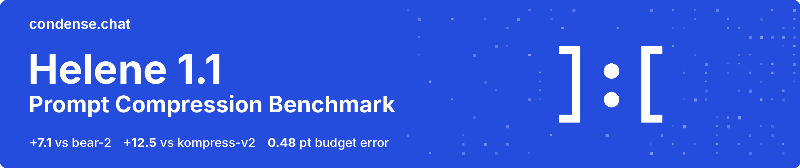
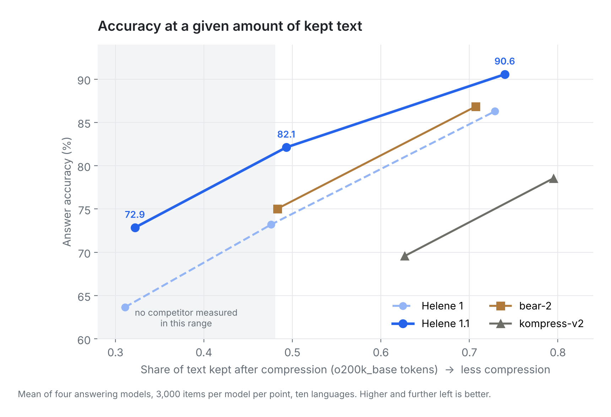
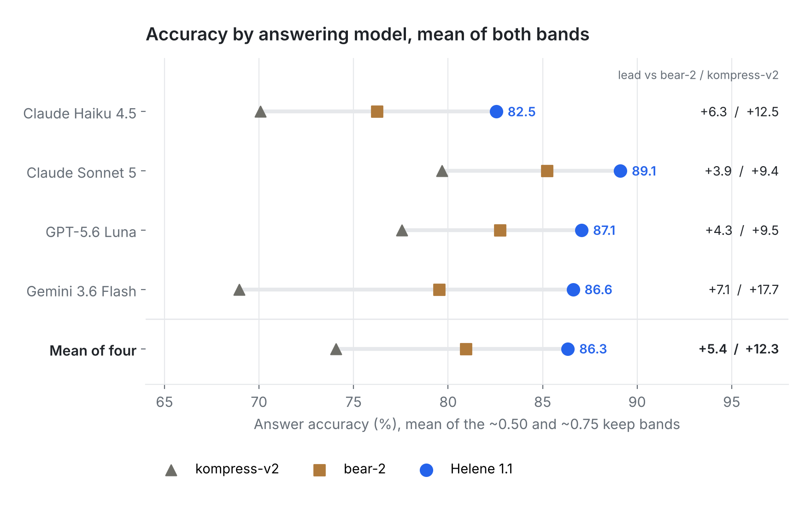
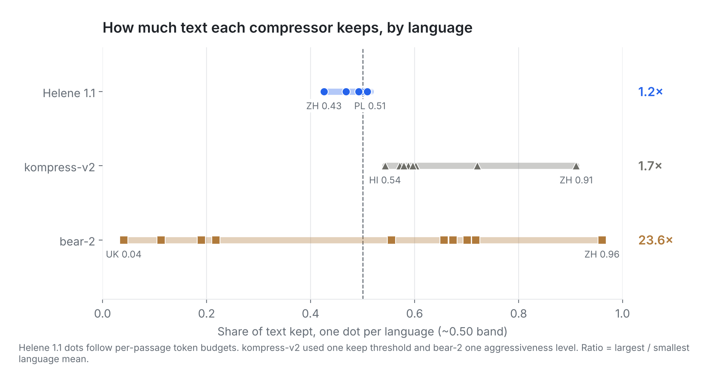
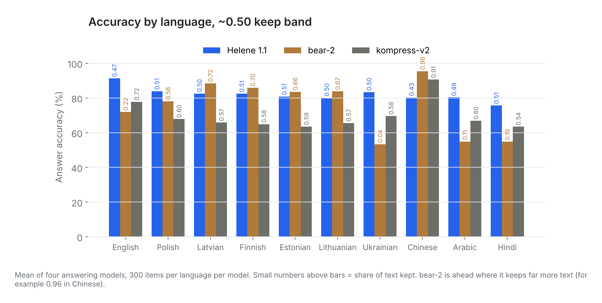

<p align="center">
  
</p>

<p align="center">
  <a href="https://github.com/condense-chat/helene-1-1-prompt-compression-benchmark/actions/workflows/reproduce.yml"></a>
  
  
  
  
  
  
</p>

# Helene 1.1 Prompt Compression Benchmark

**Per-item results for Helene 1.1, a multilingual extractive prompt compressor, against bear-2 and kompress-v2 on the public [Lost in Compression](https://arxiv.org/abs/2608.26175) benchmark.** The repository contains every scored answer from every answering model, the share of text each compressor kept, and a script that rebuilds every number and chart in the [write-up](https://condense.chat/blog/helene-1-1/) from that data.

Prompt compression (also called LLM context compression or token reduction) deletes part of a prompt before the model call, so fewer input tokens are billed and processed. Two things decide whether a compressor is usable in production: **how much answer accuracy survives a given cut**, and **whether the cut you request is the cut you get**. This benchmark measures both. Throughout, **keep rate** is the share of the passage's tokens left after compression: 0.50 means half the text was kept.

Use this repository to check the published claims, to compare your own compressor against the same items, or to study how accuracy varies by language and answering model.

> **Disclosure.** Helene is developed by [condense](https://condense.chat). The authors ran the Helene arm. Competitor outputs come from the benchmark's own cache (kompress-v2) and the vendor API (bear-2).

---

## Prompt compression benchmark results

| Keep band | Helene 1.1 | bear-2 | kompress-v2 |
|---|---|---|---|
| **~50% band** | **82.1%** accuracy at 0.49 kept | 75.0% at 0.48 kept | 69.6% at 0.63 kept |
| **~75% band** | **90.6%** accuracy at 0.74 kept | 86.8% at 0.71 kept | 78.6% at 0.79 kept |

Accuracy is the mean of four answering models (Claude Haiku 4.5, Claude Sonnet 5, GPT-5.6 Luna, Gemini 3.6 Flash) over 3,000 items: 300 questions in each of ten languages.

| Helene 1.1 lead | Margin (points) | 95% CI |
|---|---|---|
| vs bear-2, ~50% band | **+7.1** | 5.7 to 8.5 |
| vs bear-2, ~75% band | **+3.7** | 2.9 to 4.7 |
| vs kompress-v2, ~50% band | **+12.5** | 10.7 to 14.6 |
| vs kompress-v2, ~75% band | **+12.0** | 10.1 to 14.0 |

Intervals are 95% bootstrap intervals that resample the 166 source passages (2,000 resamples), so all questions and languages from one passage move together. The kompress-v2 comparisons are not at matched keep rates: kompress-v2 keeps 13.4 and 5.5 points **more** text than Helene 1.1, which favours kompress-v2.

- **Each answering model scores Helene 1.1 higher**: by 3.9 to 7.1 points over bear-2 and 9.4 to 17.7 points over kompress-v2 (point estimates, mean of both bands).
- **Budget fidelity**: given a per-passage token budget, Helene 1.1 delivered it with a mean absolute error of 0.48 percentage points; 88.5% of passages landed within one token (reported by the authors).
- **Helene 1.1 improves on Helene 1** by 9.2, 9.1 and 4.3 points at the three keep rates tested.
- **Results hold without the items flagged by the contamination screen** (see [Contamination check](#contamination-check)).

<p align="center">
  
</p>

---

## Reproduce the numbers

```bash
git clone https://github.com/condense-chat/helene-1-1-prompt-compression-benchmark.git
cd helene-1-1-prompt-compression-benchmark
pip install -r requirements.txt   # tested with Python 3.13
make all                          # or: python scripts/reproduce.py && python scripts/make_figures.py
```

No API keys and no model calls. `scripts/reproduce.py` reads the per-item CSV files in [`data/`](data/), writes every table to [`results/`](results/), and checks 19 numbers from the write-up. A check passes only if the data rounds to exactly the digits published:

```text
19/19 published numbers reproduced. Results written to results/
```

This rebuilds the statistics from the scored answers. It does not rerun compression or the answering models; see [Compressed outputs](#compressed-outputs). The full report is in [`results/RESULTS.md`](results/RESULTS.md). GitHub Actions reruns the check on every push and fails if the committed results drift from the data. Figures use the Inter font; without it they fall back to DejaVu Sans and differ slightly in rendering.

---

## Results by answering model, language and token budget

### Accuracy by answering model

<p align="center">
  
</p>

The identical compressed text was given to four models from three providers and scored separately. The gap is smallest on Claude Sonnet 5 and largest on Gemini 3.6 Flash. Four models are not enough to establish why.

### Token budget fidelity: does a compressor keep what you ask?

Helene 1.1 accepts an exact per-passage token budget. In this run the budgets were set per passage and averaged 49.4% of the passage. Across 1,660 passages, delivered size matched the budget with a **mean absolute error of 0.48 percentage points**; **46%** of passages landed exactly on budget and **88.5%** within one token. No language averaged above 0.64 points. These figures are reported by the authors from the unpublished outputs and are listed in [`data/helene_budget_fidelity_reported.json`](data/helene_budget_fidelity_reported.json); they cannot be rebuilt from this repository.

bear-2 accepts an aggressiveness level and kompress-v2 a keep threshold, so neither can be given a target size. At one fixed setting, the share of text they keep varies widely by language:

<p align="center">
  
</p>

| System | Lowest language | Highest language | Ratio |
|---|---|---|---|
| bear-2 | Ukrainian 0.04 | Chinese 0.96 | 23.6× |
| kompress-v2 | Hindi 0.54 | Chinese 0.91 | 1.7× |
| Helene 1.1 | Chinese 0.43 | Polish 0.51 | follows its per-passage budgets |

### Multilingual accuracy by language

<p align="center">
  
</p>

At the ~50% band, bear-2 scores higher than Helene 1.1 in five languages (Latvian, Finnish, Estonian, Lithuanian, Chinese), each time while keeping far more text (0.66 to 0.96 against Helene's 0.43 to 0.51). Where bear-2 keeps less text, as in Ukrainian (0.04), Arabic (0.11) and Hindi (0.19), its accuracy falls to 53 to 55%. The averaged ~50% band therefore mixes languages where bear-2 cut very little with languages where it cut almost everything. Per-language tables are in [`results/accuracy_by_language.csv`](results/accuracy_by_language.csv).

---

## Method

| Item | Detail |
|---|---|
| **Benchmark** | [Lost in Compression](https://arxiv.org/abs/2608.26175) by Mantas Lukauskas ([code](https://github.com/MantasLukauskas/lost-in-compression)), built on [Belebele](https://aclanthology.org/2024.acl-long.44/) questions over [FLORES-200](https://arxiv.org/abs/2207.04672) passages |
| **Task** | Multiple-choice reading comprehension. A compressor shortens the passage, then an answering model reads it and answers |
| **Items** | 300 questions in each of 10 languages (EN, PL, LV, FI, ET, LT, UK, ZH, AR, HI), 3,000 in total, over 166 parallel passages |
| **Answering models** | claude-haiku-4-5, claude-sonnet-5, gpt-5.6-luna, gemini-3.6-flash |
| **Harness** | Benchmark harness, items, prompts, scoring and pairing used unmodified (commit `23fc4c7`) |
| **Unparsed answers** | Scored as wrong, as in the harness. At the ~50% band: Helene 1.1 258, bear-2 891, kompress-v2 953 of 12,000 answers each; at the ~75% band: 98, 237 and 497. Almost all come from Gemini 3.6 Flash and Claude Haiku 4.5 |
| **Deviation** | gpt-5.6-luna ran with `max_tokens = 16` instead of 8, because the API used rejects a cap of 8 |
| **Keep rate** | Output tokens divided by input tokens, counted with `o200k_base` for every language, averaged over items. For a single item it can exceed 1 when a compressor returns more tokens than it received, which kompress-v2 does on some items in both bands |
| **Matching** | Each competitor point is compared with the Helene 1.1 point that leaves the closest amount of text, in bands around 0.50 and 0.75 |

**Systems**

- **Helene 1.1**: the current release, run with per-passage token budgets. It is extractive: its output is a subset of the input, in the original order.
- **Helene 1**: the previous release, included as a reference in the Helene curve.
- **bear-2**: called live through The Token Company's API at aggressiveness 0.75 for the ~50% band and 0.33 for the ~75% band. Its documentation publishes no mapping from aggressiveness to the share of text kept.
- **kompress-v2**: outputs from the benchmark's published compression cache at its 0.5 and 0.75 settings, byte-identical to the benchmark's own arm. Its model card's threshold-to-rate table bottoms out at 0.705 kept.

---

## Data

All files are plain CSV or JSON. No passage text, questions, answer choices, model outputs, compressed text or model weights are included.

| File | Rows | Contents |
|---|---|---|
| [`data/accuracy_band50.csv`](data/accuracy_band50.csv) | 36,000 | ~50% band: Helene 1.1, bear-2, kompress-v2 × 4 models × 3,000 items |
| [`data/accuracy_band75.csv`](data/accuracy_band75.csv) | 36,000 | ~75% band: Helene 1.1, bear-2, kompress-v2 × 4 models × 3,000 items |
| [`data/keep_rates_by_language.csv`](data/keep_rates_by_language.csv) | 60 | Mean share of text kept per band, system and language |
| [`data/helene_curve_summary.csv`](data/helene_curve_summary.csv) | 24 | Helene 1 and Helene 1.1 at nominal rates 0.33, 0.5 and 0.75: accuracy and keep rate per answering model |
| [`data/contamination_flagged_items.json`](data/contamination_flagged_items.json) | 19 | Evaluated items flagged by the contamination screen |
| [`data/helene_budget_fidelity_reported.json`](data/helene_budget_fidelity_reported.json) | | Aggregate budget-fidelity figures reported by the authors |

**Accuracy columns**: `model`, `item_id` (Belebele source URL with question number), `lang`, `system`, `parsed` (1 if an answer option could be read from the response), `correct` (0 or 1). Keep rates are published as per-language averages only.

Join to the benchmark on `item_id` and `lang`. The ~50% band and the Helene curve come from separate answering runs over the same compressed text, so Helene 1.1 at nominal 0.5 differs slightly between them (82.1% and 82.3%).

---

## Contamination check

Helene's training data was screened for overlap with Belebele passages. **19 evaluated English items were flagged** and are listed in [`data/contamination_flagged_items.json`](data/contamination_flagged_items.json). Removing them changes the margins by at most 0.08 points:

| Helene 1.1 lead | All items | Without flagged items |
|---|---|---|
| vs bear-2, ~50% band | +7.08 | +7.00 |
| vs kompress-v2, ~50% band | +12.54 | +12.55 |
| vs bear-2, ~75% band | +3.72 | +3.72 |
| vs kompress-v2, ~75% band | +12.01 | +12.05 |

---

## Limitations of this prompt compression benchmark

- **Two external baselines.** The comparison covers bear-2 and kompress-v2 only, with no random-deletion or truncation control.
- **One setting per competitor per band.** bear-2 and kompress-v2 were not swept, so the bands are matched on average keep rate across languages, not per language.
- **One task type.** Multiple-choice reading comprehension on short passages. Agent traces, code, JSON tool outputs and long multi-document contexts are not tested.
- **Unmatched kompress-v2 points.** kompress-v2 does not reach Helene's lower keep rates, so it is compared at higher retention.
- **Different interfaces.** Helene 1.1 accepts a target size; the others do not, and the budgets were set by the authors. Rate-fidelity results reflect this design difference as well as each system's behaviour.
- **One tokenizer.** Keep rate uses `o200k_base` for all ten languages, which splits some scripts into more tokens than others.
- **Mixed execution.** kompress-v2 outputs come from the published cache, bear-2 was called live, and Helene was run by its developers.
- **Point estimates per model and language.** Confidence intervals are reported for the pooled band margins only.
- **No baseline below ~48% kept.** No competitor configuration reached that range.

---

## Compressed outputs

The compressed passages are not published, so this repository verifies the statistics, not the compression itself. SHA-256 hashes of the compressed outputs for the ~50% band (all three systems) and the Helene curve are listed in [`HASHES.txt`](HASHES.txt), which fixes exactly which outputs were scored.

---

## Repository layout

```text
.
├── assets/                 README figures and banner
├── data/                   per-item results (CSV) and contamination summary
├── results/                generated tables, RESULTS.md and checks.csv
├── scripts/
│   ├── reproduce.py        rebuilds every number and checks the write-up
│   └── make_figures.py     rebuilds every chart
├── HASHES.txt              SHA-256 of the unpublished compressed outputs
├── CITATION.cff
├── LICENSE                 MIT (code)
└── LICENSE-DATA.md         CC BY-SA 4.0 (data)
```

---

## Citation

```bibtex
@misc{condense2026helene11,
  title        = {Helene 1.1 Prompt Compression Benchmark: Accuracy and Rate Fidelity on Lost in Compression},
  author       = {Filipas, Illia and {condense}},
  year         = {2026},
  howpublished = {\url{https://github.com/condense-chat/helene-1-1-prompt-compression-benchmark}},
  note         = {Per-item results and reproduction code. Write-up: \url{https://condense.chat/blog/helene-1-1/}}
}
```

Please also cite the benchmark and its data:

```bibtex
@misc{lukauskas2026lostincompression,
  title         = {Lost in Compression: A Controlled Cross-Lingual Audit of Extractive Prompt Compressors},
  author        = {Lukauskas, Mantas},
  year          = {2026},
  eprint        = {2608.26175},
  archivePrefix = {arXiv}
}

@inproceedings{bandarkar-etal-2024-belebele,
  title     = {The Belebele Benchmark: a Parallel Reading Comprehension Dataset in 122 Language Variants},
  author    = {Bandarkar, Lucas and Liang, Davis and Muller, Benjamin and Artetxe, Mikel and Shukla, Satya Narayan and Husa, Donald and Goyal, Naman and Krishnan, Abhinandan and Zettlemoyer, Luke and Khabsa, Madian},
  booktitle = {Proceedings of the 62nd Annual Meeting of the Association for Computational Linguistics (Volume 1: Long Papers)},
  year      = {2024},
  pages     = {749--775},
  url       = {https://aclanthology.org/2024.acl-long.44/}
}

@misc{nllb2022,
  title         = {No Language Left Behind: Scaling Human-Centered Machine Translation},
  author        = {{NLLB Team}},
  year          = {2022},
  eprint        = {2207.04672},
  archivePrefix = {arXiv}
}
```

---

## License

Code is released under the [MIT License](LICENSE). Data in `data/` and `results/` is released under [CC BY-SA 4.0](LICENSE-DATA.md), matching Belebele; this repository contains item identifiers and scores, not Belebele or FLORES-200 text. bear-2, kompress-v2 and the answering models are the property of their respective owners.

<p align="center">
  <sub>Built by <a href="https://condense.chat">condense</a>, context management for LLM applications.</sub>
</p>
